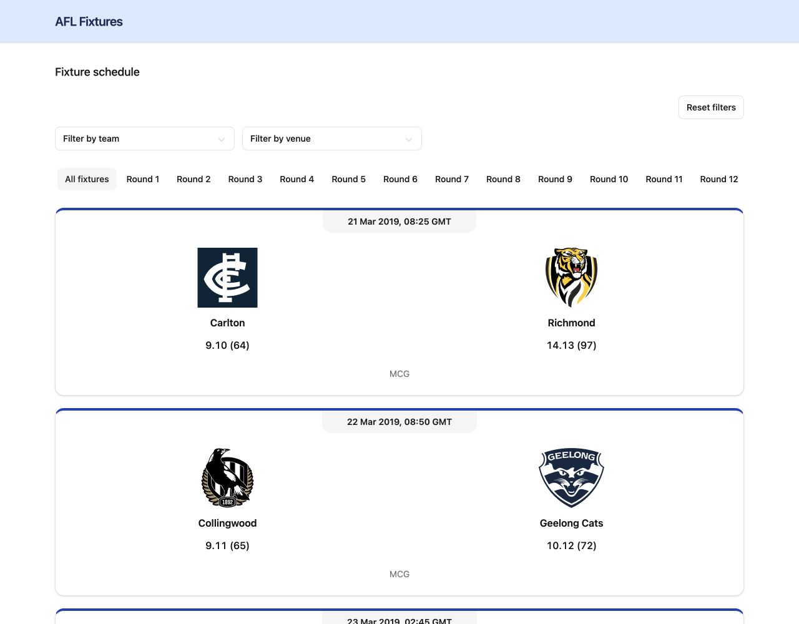
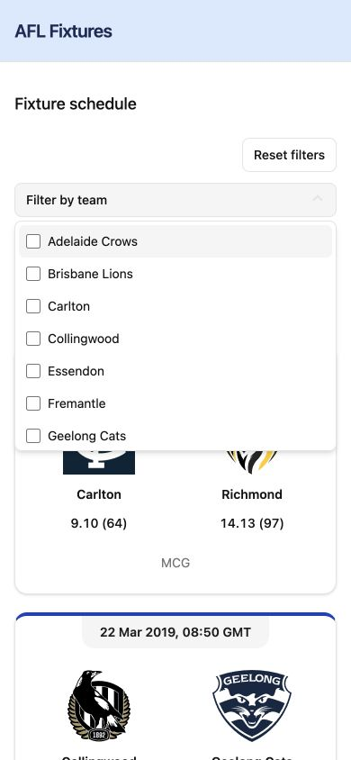

# AFL Fixture / Schedule Client

A React and TypeScript client for browsing AFL fixtures from the supplied challenge API. Users can view match details and combine round, team, and venue filters without requesting the fixture again.

## Screenshots

Desktop view with the full fixture list and combined filters:



Mobile view with the team dropdown expanded:



## Run locally

Use the Node version in [`.nvmrc`](.nvmrc) (24.22.2). The package engine requires Node >=22.12.0.

```sh
nvm use
npm ci
npm run dev
```

Open the local URL printed by Vite. No `.env` file, API key, or backend setup is required. The public API base URL and `/fixture` path are defined in [`fixtureService.ts`](src/features/fixtures/services/fixtureService.ts). Internet access and the remote service's browser CORS support are required for live data and logos.

```sh
npm run build      # Type-check and create the production build in dist/
npm run lint       # Check source with Oxlint
npm run preview    # Serve the production build locally after building
npm test           # Run unit, component, and DOM accessibility tests
npm run test:watch # Run tests in watch mode
```

## Challenge coverage

| Requirement | Implementation |
| --- | --- |
| List all matches from the supplied fixture endpoint | The response is flattened across every phase and round and rendered as a list, without pagination. Bye entries are represented separately. |
| Date, team names, logos, scores, and venue | Standard match cards display these details. Scores use goals.behinds (points); kickoff uses the browser's local time zone with a zone label. |
| Filter by round | Single-round selection, with “All fixtures” removing the round restriction. Round labels use their full API names, such as Round 1 and Finals Round 1. Empty rounds are retained as options. |
| Supplied team-logo source | URLs use each squad's code. A failed logo leaves the team name visible. |
| Functional components and TypeScript | UI components and the filter hook are functional and typed. The native React rendering-error boundary is the sole class component, required by React's boundary lifecycle. |
| Code organisation | Fixture components, services, types, formatting, and filtering have separate ownership paths. |
| Mobile-first design | Filters wrap or scroll within their available space; cards display one per row with responsive spacing. |
| README documentation | Setup, dependencies, behavior, architecture, trade-offs, and limitations are documented here. |
| Extra credit: team filtering | Multi-select options include distinct home and away teams from the complete dataset. |
| Extra credit: venue filtering | Multi-select options include distinct available venues from the complete dataset. |

Data sources:

- [Fixture endpoint](https://0p0s8y841d.execute-api.ap-southeast-2.amazonaws.com/test/react-code-test/fixture).
- Team-logo template: `https://react-code-test.s3.ap-southeast-2.amazonaws.com/logos/{code}.svg`.

## Filter behavior

Team and venue dropdowns appear above the round controls, with **Reset filters** aligned to the right. Both support multiple selections. Their options come from the full parsed response and remain available when other filters narrow the results. Team and venue names are sorted alphabetically and deduplicated by ID.

Selections within a filter use OR; different filters use AND. For example, selecting Carlton and Richmond, MCG, and Round 1 shows Round 1 games at MCG involving either team. A match appears once even if both participants are selected. No selected teams or venues means no restriction for that filter.

Changing one filter preserves the others. “All fixtures” removes only the round restriction. **Reset filters** clears team and venue selections and returns the round to “All fixtures”, restoring the complete dataset. There are no separate “All teams” or “Clear teams” controls.

Bye entries have special rules because they may lack an opponent, venue, date, and score:

- A specific round selection excludes byes.
- With “All fixtures” selected and no venue restriction, byes are visible; active team selections restrict them to those teams.
- An active venue filter excludes entries without a matching venue, including the current response's byes.

Loading, request errors, an empty successful response, and a filter combination with no matches have distinct presentation. Filters appear after a successful load and remain usable when a combination has no results. API failures currently have no Retry button.

## Dependencies

Declared packages and ranges are in [`package.json`](package.json); [`package-lock.json`](package-lock.json) records resolved versions.

| Package | Role |
| --- | --- |
| React 19 and React DOM | Components, hooks, state, and browser rendering. |
| @tanstack/react-query | Fixture request state, shared in-memory caching, retries, and cancellation. |
| Vitest, React Testing Library, user-event, jest-dom, and jsdom | Test runner, component/hook interactions, assertions, and simulated DOM. |
| axe-core | Development-only DOM accessibility checks; contrast and screen-reader behavior require separate review. |
| TypeScript 7 and React/Node typings | Static checking of application and tooling code. |
| Vite 8 and its React plugin | Development server and production build. |
| Tailwind CSS 4 and its Vite plugin | Utility classes, responsive layout, and theme tokens. |
| Oxlint | Source linting. |
| shadcn and tw-animate-css | Existing UI scaffolding/configuration and imported CSS assets. |
| class-variance-authority | Retained from scaffolding; currently unused by application source. |

The custom filters use HTML controls and CSS rather than a UI runtime library. Radix UI, cn, and lucide-react were removed. TanStack Query manages fixture requests using the existing browser fetch service and parser.

## Architecture decisions

| Decision | Reason and consequence |
| --- | --- |
| Separate server data from filter state | TanStack Query owns fetched FixtureData; useFixtureFilters owns user selections. Refreshed responses update options/results without resetting selections while the hook stays mounted. |
| Reuse a service and parser behind useFixtures | The service handles HTTP and cancellation; the parser validates the expected structure and adapts it for rendering. The query hook coordinates fetching, caching, and retries without embedding API traversal in the page. |
| Derive options and visible fixtures | The original response remains intact. Keeping derived results out of state avoids synchronising multiple fixture copies as filters change. |
| Keep three local useState selections | Round, team, and venue selection are small and independent; reset updates them together. A reducer or global store would add structure without a current need. |
| Use controlled, reusable filter controls | RoundFilter and the team/venue adapters receive values and callbacks. MultiSelect owns only panel visibility, so selection rules remain in one hook and the same control serves both team and venue filters. |
| Build on native inputs and CSS | Radio inputs and checkboxes provide browser interaction without additional UI runtime packages. The custom dropdown owns its focus and dismissal behavior, which is covered by interaction tests. |
| Scope rendering failures to the fixture feature | The error boundary preserves the page shell. Request/parse failures use the query error state; rendering failures use the boundary. |

Data flows from the fixture endpoint through the service, parser, and query cache into useFixtureFilters, then into controlled filters and fixture cards. Query settings and known data assumptions are documented below.

## Organisation and custom hooks

```text
src/
  components/
    errors/                 Rendering-error boundary
    layout/                 Header and footer
    ui/                     Card, Alert, and reusable MultiSelect
  features/fixtures/
    components/             Fixture page/cards, teams, and filter adapters
    hooks/
      useFixtures.ts        TanStack Query fetching and cache settings
      useFixtureFilters.ts  Local filter selection and derived results
    services/               HTTP request and response parsing
    types.ts                Fixture data and filter-option types
    utils/formatKickoff.ts   Browser-local kickoff formatting
  test/                     Synthetic fixtures, query-client helpers, and test setup
```

[`useFixtures`](src/features/fixtures/hooks/useFixtures.ts) fetches and caches the complete parsed response through TanStack Query. A QueryClientProvider in main.tsx supplies one shared QueryClient. [`FixturePage`](src/features/fixtures/components/FixturePage.tsx) consumes the query’s data, pending state, and error rather than maintaining a fetch effect and duplicate request state. The query’s AbortSignal is passed to the existing fetch service for cancellation. [`parseFixtures`](src/features/fixtures/services/parseFixtures.ts) traverses `phases[].rounds[].matches[]`, attaches each match's enclosing round name, and returns `FixtureData`: the flat fixture list and round names grouped by phase, including empty rounds.

[`useFixtureFilters`](src/features/fixtures/hooks/useFixtureFilters.ts) owns round, team, and venue selection state. It prepares distinct options, derives the visible fixture list, and exposes `selectRound`, `selectTeams`, `selectVenues`, and `resetFilters`. Keeping these rules together avoids growing the page component whenever a filter is added. The full fixture response is preserved; filtered copies are not stored in state.

The hook uses three useState values, which are sufficient for the current filters. It does not fetch data, persist selections across unmounts, or require a global store. Data updates preserve the current selections rather than automatically clearing them.

[`MultiSelect`](src/components/ui/multi-select.tsx) is shared by the team and venue adapters. The caller owns selected values; only open/closed panel state is local. It uses a button with expanded-state information, labelled native checkboxes, keyboard focus, outside-click dismissal, Escape dismissal with focus return, and a scrollable panel. The round filter uses native radio inputs.

## Query settings

The fixture query uses the key `['fixtures']`; filter selections are deliberately excluded because filtering happens locally over the same dataset. Its current configuration is:

```ts
queryKey: ['fixtures'],
staleTime: 5 * 60 * 1000,
retry: 3,
```

TanStack Query manages server-data freshness and request status. The filter hook independently manages user selections, so a query refresh does not reset the active filters.

- **`staleTime: 5 * 60 * 1000` (five minutes):** A successful response stays fresh for five minutes. After that it is stale and eligible for refresh on mount, window focus, or reconnect using TanStack Query’s defaults. This does not poll the endpoint every five minutes, and we do not assume the dataset is static.
- **`retry: 3`:** A failed query gets up to three retries after the initial attempt (four attempts in total), using TanStack Query’s default exponential retry delay. The page stays pending during initial retries and displays the error after they are exhausted. Fetch, JSON, and parsing failures all follow this policy.
- **Freshness is not persistence:** The five-minute stale time controls refresh eligibility. Separately, unused queries use TanStack Query’s default five-minute garbage-collection window. A full browser reload clears this in-memory cache; explicit refetch or invalidation can refresh data before the stale time elapses.

Fetching and filter selection remain separate. A new successful response rebuilds options/results without clearing the filter hook’s selections; remounting the filter hook itself resets those selections. No polling, persistent cache, or manual Retry button has been added.

## Trade-offs and assumptions

- **Ordering:** Phases, round options, and matches preserve API response order. We assume the API supplies them in the intended display order and do not sort them in the client. A live response check found Round 1–Round 23 followed by Finals Round 1–Finals Round 4 in order; this is an observation, not a guaranteed API contract. Team and venue options are still sorted alphabetically.
- **Team and venue identity:** Options assume stable IDs with consistent names. The parser does not validate every field in the TypeScript model, so incompatible identity data remains a limitation. No fallback identity rule is invented.
- **Response support:** The parser targets the supplied completed-match and bye structure. Non-bye entries currently require scores, a venue, both teams, and a parseable kickoff. Upcoming or unscheduled matches missing these fields are not generally supported. A rejected entry fails the response rather than being silently dropped.
- **Client-side filtering:** Fetching the complete response makes filtering immediate and avoids extra API calls, but renders the full list without pagination or virtualisation.
- **Local time:** Kickoff formatting follows the viewer's browser time zone. Older feature documentation mentions GMT, but the current implementation preserves browser-local formatting.
- **Rendering failures:** React's native error boundary needs a class component; the boundary wraps fixture content so the surrounding application layout remains visible on a rendering failure.

## Tests and verification

After `npm ci`, run these commands from the repository root. Tests do not require the development server or a running backend.

```sh
npm test
```

Runs the complete suite once and exits with a nonzero status if a test fails. The latest verified run contains **73 passing tests across seven files**, including parameterized cases.

```sh
npm run test:watch
```

Starts Vitest watch mode for development; relevant tests rerun as files change. Press `q` to exit.

Run an individual file or tests matching a name:

```sh
npm test -- src/features/fixtures/hooks/useFixtureFilters.test.ts
npm test -- src/features/fixtures/hooks/useFixtures.test.tsx
npm test -- -t "reset clears every restriction"
```

### Test coverage

| Suite | Behaviors covered |
| --- | --- |
| [Filter hook](src/features/fixtures/hooks/useFixtureFilters.test.ts) | Initial state; round ordering and empty rounds; distinct alphabetical team/venue options; home/away matching; OR within selections and AND between filters; no duplicate matches; stable options; bye visibility; independent selection changes; reset; empty results; refreshed data preserving selections; no input mutation. |
| [Fixture query](src/features/fixtures/hooks/useFixtures.test.tsx) | Parsed response and cancellation signal; three retries after the first failure; recovery during retries; fresh cache reuse on remount/focus; cancellation on unmount; five-minute freshness boundary; explicit refresh preserving filter selections. |
| [Fixture page](src/features/fixtures/components/FixturePage.test.tsx) | Loading and control visibility; successful cards, byes, and zero scores; network/HTTP/JSON/payload failures; successful empty responses; unmount cancellation and obsolete results; StrictMode behavior; combined filters without refetching; reset; bye rules; contextual no-results messages; empty round controls. |
| [Response parser](src/features/fixtures/services/parseFixtures.test.ts) | Flattening phases/rounds in response order; enclosing round names; empty rounds/collections; minimal bye entries; zero scores; rejection of malformed collections and incomplete or invalid standard matches. |
| [Fetch service](src/features/fixtures/services/fixtureService.test.ts) | Endpoint and AbortSignal forwarding; JSON decoding; HTTP errors; network failures; invalid JSON; cancellation propagation. |
| [Multi-select control](src/components/ui/multi-select.test.tsx) | Open/closed state and accessible labels; multiple selections and deselection; selected counts; keyboard opening/selection; Escape with focus return; outside-click and Tab dismissal; external reset; string values and empty options. |
| [DOM accessibility](src/test/accessibility.test.tsx) | axe checks of loading, results, open team/venue panels, empty filter results, an empty response, and request-error presentation. |

### Test setup and boundaries

Vitest runs React Testing Library and user-event tests in jsdom, with jest-dom assertions. [Synthetic fixture data](src/test/fixtures.ts) keeps cases small and predictable. Fetch requests are mocked; no test calls the live fixture API.

[Query test helpers](src/test/queryClient.tsx) create isolated clients and clear them after tests. Retry delays are zero in tests so the production three-retry policy can be exercised quickly; production backoff is unchanged. Cache-age tests set response timestamps instead of waiting five minutes.

[Shared setup](src/test/setup.ts) cleans up rendered components and stubbed globals after each test. scrollIntoView is mocked because jsdom does not calculate layout. These tests verify behavior and DOM semantics, not visual positioning, actual scrolling, or mobile-browser rendering.

The axe suite disables color-contrast checks because jsdom cannot evaluate them reliably. Contrast, layout, and actual screen-reader behavior require separate review; score aria-label support remains a manual-review finding. Earlier browser checks exercised keyboard interaction and 320 px layouts, but do not establish full accessibility compliance.

For the complete local verification sequence:

```sh
npm test
npm run build
npm run lint
git diff --check
```

The local sample data remains in the repository but is not used as an API-failure fallback. Feature briefs and the repository ontology provide additional context, but some describe earlier increments; re-check current source before relying on their implementation descriptions.

## Agent skills

This repository includes four project skills, written in the open Agent Skills format, for an incremental process from feature definition through implementation and review. The shared instructions are in [`.agents/skills/`](.agents/skills/); [`.claude/skills/`](.claude/skills/) exposes the same skills to Claude Code through links to those `SKILL.md` files. This keeps one copy of each workflow for both tools. Each skill also has an `agents/openai.yaml` metadata file for Codex; Claude Code uses the shared `SKILL.md` and does not need that file.

| Skill | Use it when | What it does |
| --- | --- | --- |
| [`define-feature`](.agents/skills/define-feature/SKILL.md) | A new feature needs a clear scope before implementation. | Produces a concise brief with the user outcome, behavior, decisions and assumptions, trade-offs, open questions, and verifiable acceptance criteria. |
| [`build-feature`](.agents/skills/build-feature/SKILL.md) | A feature brief has been agreed and is ready to implement. | Delivers one bounded increment, follows repository patterns, and verifies the work against acceptance criteria. |
| [`review-change`](.agents/skills/review-change/SKILL.md) | A specific diff or implemented increment needs review. | Checks for evidence-backed correctness, security, reliability, complexity, and verification issues; reports findings without changing the reviewed code. |
| [`generate-repository-ontology`](.agents/skills/generate-repository-ontology/SKILL.md) | Documentation mapping the current codebase needs to be generated or refreshed. | Creates concise, source-backed technical context and navigation to help future contributors understand and safely change the project. |

### Install and use the skills

For this project, clone the repository and open the checkout in the coding tool. No separate package or global skill installation is required:

```sh
git clone <repository-url>
cd afl-fixtures
```

Codex discovers project skills from `.agents/skills/<skill-name>/SKILL.md`. Claude Code discovers project skills from `.claude/skills/<skill-name>/SKILL.md`; this repository provides links there to the shared skill instructions. If your checkout or platform does not preserve those links, copy the skill directories from `.agents/skills/` into `.claude/skills/` for Claude Code. Keep the folder names and `SKILL.md` files intact.

Invoke a skill explicitly when you want a particular workflow:

```text
Codex:       Use $define-feature to scope fixture filtering.
Claude Code: /define-feature
```

Replace `define-feature` with `build-feature`, `review-change`, or `generate-repository-ontology` as appropriate. Claude Code can also select a skill automatically when your request matches its description. Check that the skill appears in the tool's skill list if it is not detected; in Claude Code, use `/skills` to inspect available skills. The instructions themselves are portable, but automatic discovery and invocation syntax depend on the coding tool.

For Claude Code, project-level skills are loaded from `.claude/skills/` in the repository. To install a skill for your own use across projects instead, copy its directory under `~/.claude/skills/`. For Codex, the corresponding project and user skill locations are `.agents/skills/` and `~/.agents/skills/`.
